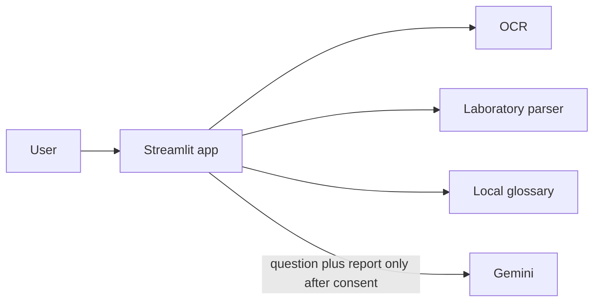
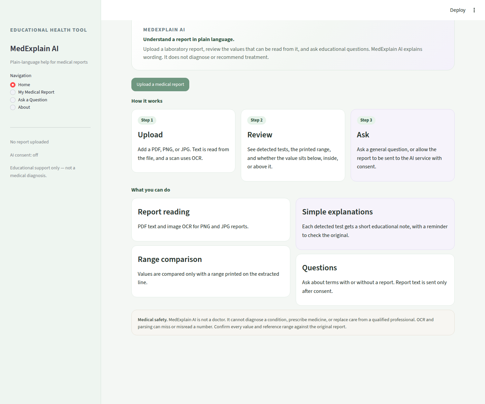
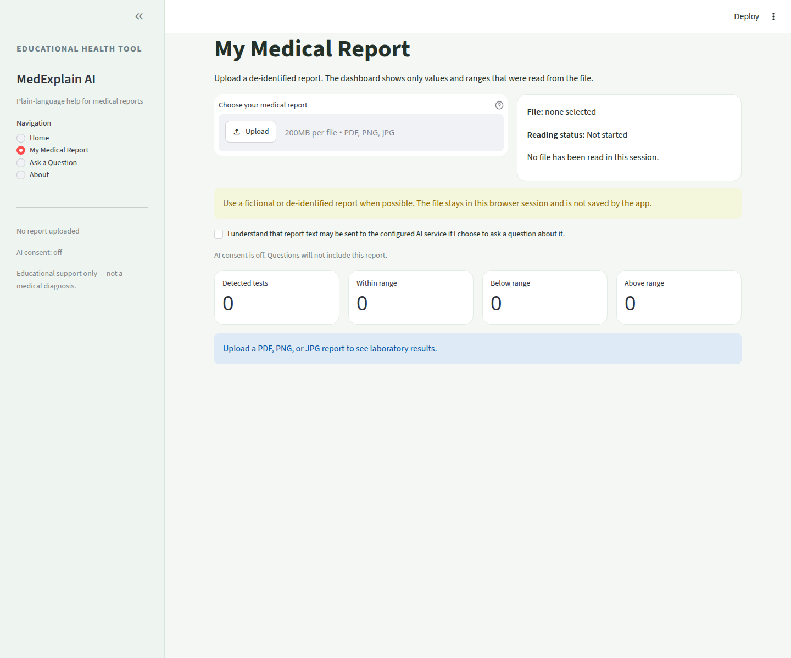
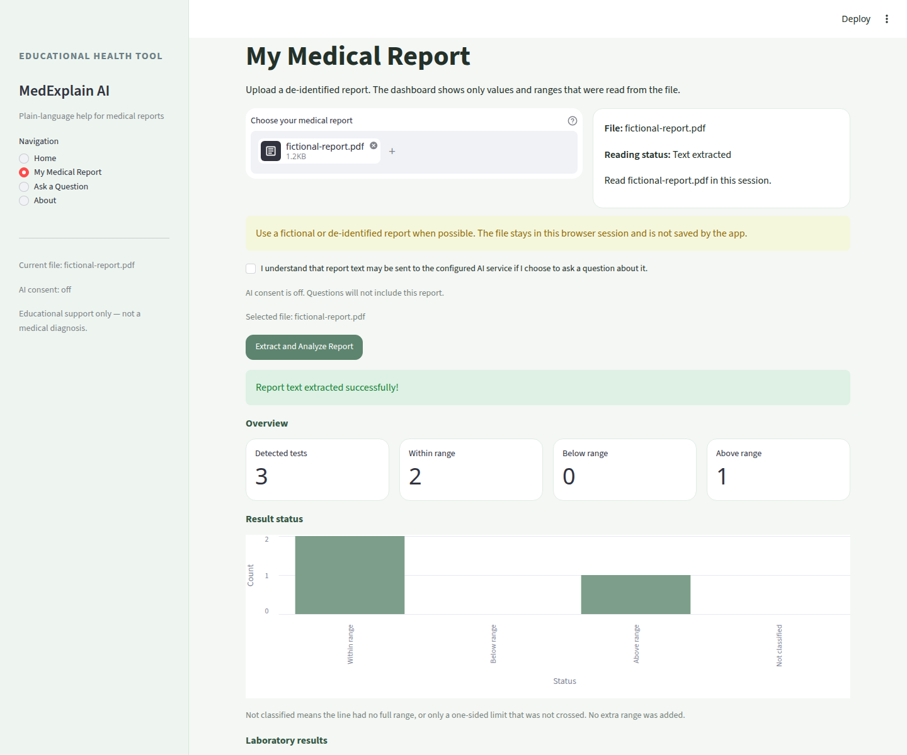
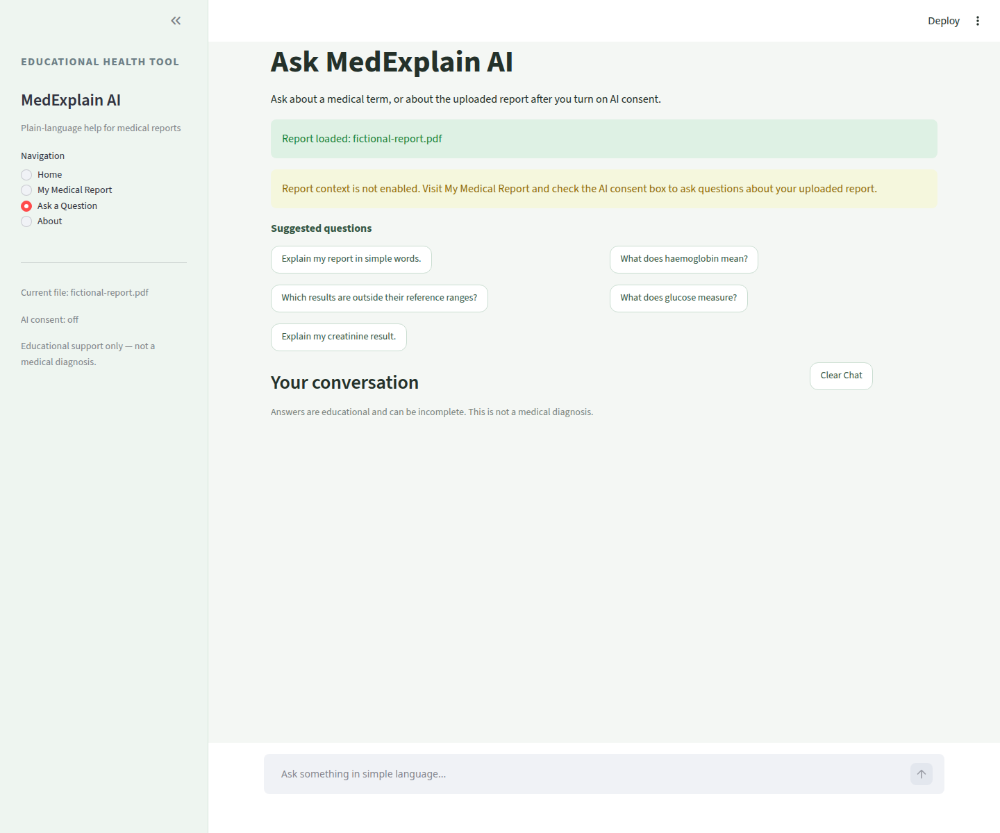
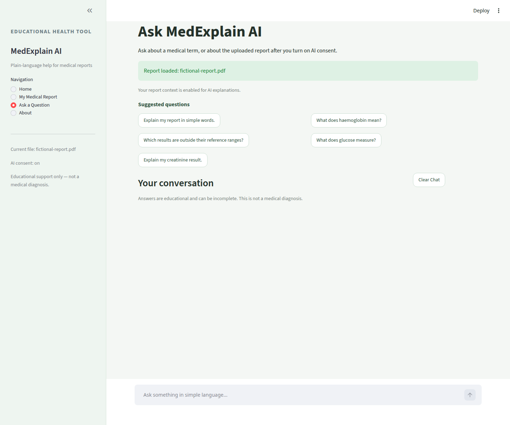
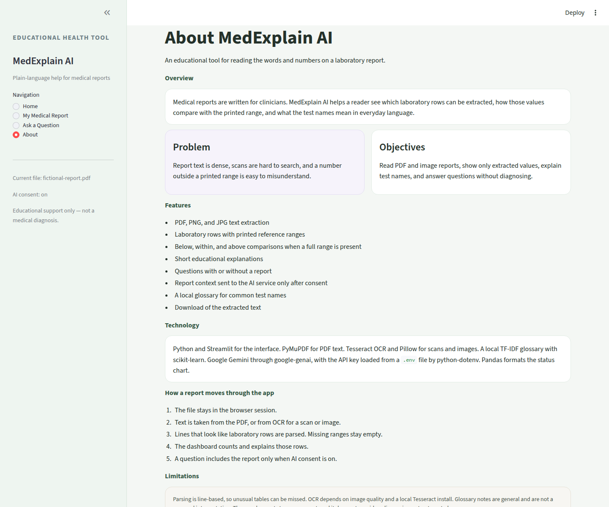

# MedExplain AI

MedExplain AI is a Streamlit application that helps a person read a laboratory report in plain language. It extracts text from a PDF or an image, lists laboratory rows it can recognize, and compares each value only with a reference range printed on that row. Optional questions are answered by Google Gemini. The report is included only after the user turns on AI consent.

This is an educational tool. It does not diagnose a condition or recommend treatment.

## Problem

Laboratory reports are written for clinicians. The wording is dense, scanned pages are hard to search, and a value outside a printed range is easy to misread as a diagnosis.

## Objectives

- Read text from PDF, PNG, and JPG reports.
- Show test names, values, units, and printed reference ranges that were actually extracted.
- Mark a result below, within, or above a range only when that range was read.
- Explain test names in everyday language.
- Answer general questions with no report, and report questions only with consent.

## Features

- PDF text extraction, with OCR for scanned PDFs and for PNG or JPG images
- Laboratory row parsing and a status summary
- Result cards with a manual-review notice
- A local glossary for common tests
- A chatbot with suggested questions, history, and source notes
- Consent control before any report text is sent to Gemini
- Download of the extracted text for the current session

## Technology

- Python and Streamlit
- PyMuPDF for PDF text
- Tesseract OCR and Pillow for images and scanned pages
- scikit-learn TF-IDF for the local glossary
- google-genai for Gemini
- python-dotenv for the API key
- pandas for the status chart

## Architecture

The browser talks only to the Streamlit app. The app calls local OCR and parsing. Gemini is called later, and only for a question whose report context was allowed.



A written version of this diagram is in [docs/architecture.md](docs/architecture.md). The question path is in [docs/workflow.md](docs/workflow.md).

## Folder structure

```text
frontend/app.py              Streamlit interface
backend/ocr.py               PDF and image text extraction
backend/report_analyzer.py   Row parsing, explanations, status counts
backend/chatbot.py           Consent filtering and Gemini calls
backend/rag.py               Local glossary retrieval
backend/__init__.py
tests/test_phase1.py         Upload, parsing, consent, and startup tests
tests/test_phase2.py         Dashboard counts, pages, and log privacy
docs/architecture.md
docs/workflow.md
docs/testing.md
requirements.txt
.env.example
```

`Scripts/`, `pyvenv.cfg`, and root `__pycache__/` were uploaded with an earlier copy of a Windows virtual environment. They are not used to run the app. `.gitignore` now ignores those paths for new files. They are still present in the existing Git history until a later commit removes them from the index.

## Installation

Use Python 3.10 or newer.

```bash
python -m venv .venv
```

Windows:

```bat
.venv\Scripts\activate
pip install -r requirements.txt
```

macOS or Linux:

```bash
source .venv/bin/activate
pip install -r requirements.txt
```

### Tesseract

Text-based PDFs do not need Tesseract. Scanned PDFs, PNG files, and JPG files do.

Windows: install the Tesseract binary and accept the default location `C:\Program Files\Tesseract-OCR\tesseract.exe`, or add the install folder to `PATH`.

macOS:

```bash
brew install tesseract
```

Debian or Ubuntu:

```bash
sudo apt install tesseract-ocr
```

### Gemini API key

Copy the example environment file and add your own key locally. Do not commit `.env`.

```bash
copy .env.example .env
```

On macOS or Linux, use `cp .env.example .env`.

```text
GEMINI_API_KEY=your_key_here
GEMINI_MODEL=gemini-2.5-flash
```

The key is optional for reading a report. It is required only when a question is sent to Gemini. The application reads `GEMINI_API_KEY` from the environment. It does not display the key.

## Run the application

From the repository root, with the virtual environment active:

```bash
streamlit run frontend/app.py
```

Streamlit prints a local URL, usually `http://localhost:8501`.

## Application workflow

1. Open **My Medical Report** and upload a fictional or de-identified PDF, PNG, or JPG.
2. Choose **Extract and Analyze Report**.
3. Review the status counts, result cards, and extracted text.
4. Leave AI consent off for general questions, or turn it on before asking about that report.
5. Open **Ask a Question**. Clearing the report or the chat removes that text from the session.

Details and a consent diagram are in [docs/workflow.md](docs/workflow.md).

## Screenshots

These pictures were taken from the running app. The report in them is a fictional PDF created for the capture. That PDF is not in the repository. No Gemini reply is shown, because no API key was configured for the capture.













Use a fictional or de-identified report for any new screenshots. Do not commit a real medical document.

## Testing

From the repository root:

```bash
python -m unittest discover -s tests -v
```

What those tests cover, and what they do not call, is recorded in [docs/testing.md](docs/testing.md). Update that file when you run the suite again. Do not paste a Gemini answer into the docs unless you produced it yourself.

## Limitations

- Row detection expects a test name and a value on a line, with a range on that line or on the next line. Complex tables can be missed.
- One-sided limits are not treated as a full within-range result.
- OCR quality depends on the scan and on Tesseract.
- Glossary text is general education, not a personal interpretation.
- Uploaded text lives in the Streamlit session until it is cleared or the session ends. It is not written to a database.

## Future enhancements

- Stronger table layout detection
- A way to correct an extracted row before a question is asked
- Optional local-only answers when no API key is configured
- Authenticated storage, if a deployment ever needs saved reports

## Safety

MedExplain AI is not a medical device and not a clinician. Compare every extracted value with the original report, and discuss personal results with a qualified professional.
