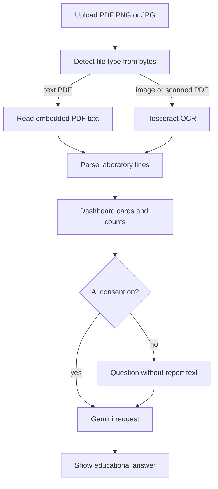

# Architecture

MedExplain AI is a single-user Streamlit application. The interface and the Python services run in one process. Report files are held in memory for the Streamlit session. They are not written to an application database.

## Components

| Piece | Role |
| --- | --- |
| `frontend/app.py` | Pages, consent checkbox, dashboard, and chat display |
| `backend/ocr.py` | Detects PDF, PNG, or JPEG bytes and returns text |
| `backend/report_analyzer.py` | Parses laboratory rows and counts statuses |
| `backend/rag.py` | Ranks a small built-in glossary with TF-IDF |
| `backend/chatbot.py` | Builds the prompt and calls Gemini when a key is set |
| `.env` | Local `GEMINI_API_KEY` and optional `GEMINI_MODEL` |

## Request path

A general question still uses Gemini when an API key is configured. The difference is the prompt content: without consent, the report section says that no report was provided, and parsed rows from the report are omitted.

## What stays local

- File bytes, extracted text, parsed rows, and chat messages stay in `st.session_state`.
- The glossary is a Python list in `backend/rag.py`. Retrieval does not call a network service.
- OCR uses a local Tesseract binary.

## What can leave the machine

A question sent from **Ask a Question** is sent to Google Gemini when `GEMINI_API_KEY` is set. The report text and parsed rows are attached only when the consent checkbox is on. The API key is taken from the environment and is not placed in the prompt.

## Failure handling

- Unreadable files raise `ReportReadError`, which the page shows as text.
- A missing API key returns a short message and does not create a Gemini client.
- A Gemini exception returns a generic failure message. The page and the application log do not print the report or the key.
