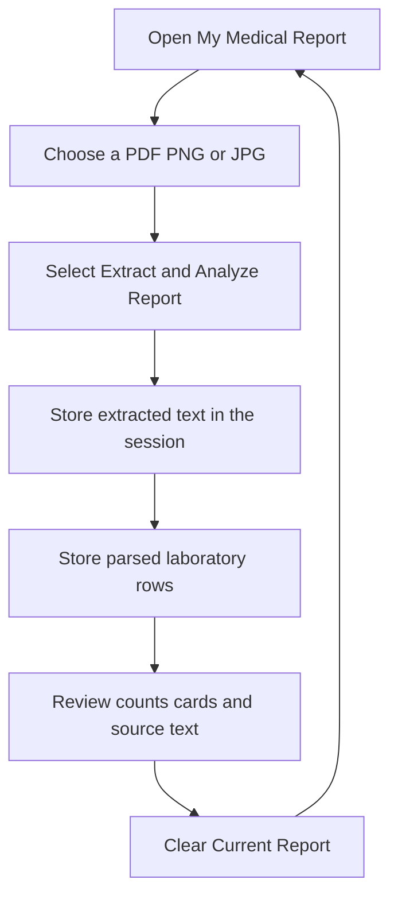
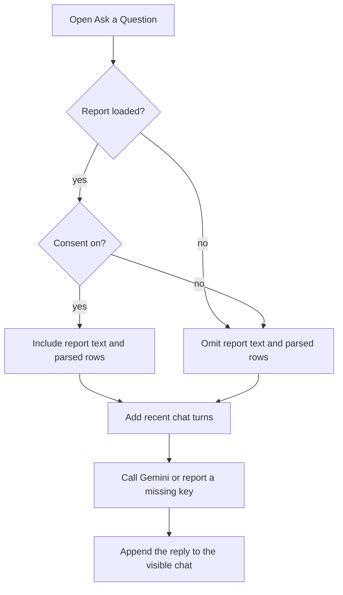

# Workflow

## Read a report

1. The file type is decided from the file bytes. The filename is only a fallback.
2. A PDF with a text layer returns that text. A PDF with no text, or a PNG or JPG, is sent to Tesseract.
3. Each kept row has a test name and a numeric value. A reference range is copied from the same line, or from the following line when that line is only a range.
4. If a bound is missing, it stays empty. The status text says that the result was not placed in a full range.
5. Every extracted row is marked for manual review.

Clearing the report removes the text, the rows, the filename, and the chat from the session. Closing the browser tab ends the session as well. The app does not save the upload to a project folder.

## Ask a question

Consent is stored separately from the checkbox widget so it still applies after the user leaves **My Medical Report**. Turning the checkbox off stops later questions from including the report. Older replies that were created with the report are hidden from the model while consent is off. They can still be visible in the chat until **Clear Chat** is used.

Suggested questions use the same path as a typed question. They do not bypass consent.

## Status words

| Stored status | Dashboard group |
| --- | --- |
| Within the reported range | Within range |
| Below the reported range, or below a printed lower limit | Below range |
| Above the reported range, or above a printed upper limit | Above range |
| No range, or a one-sided limit that was not crossed | Not classified |

Not classified is not the same as a normal result. The chart caption says that no extra range was added.
